# Sayt sahifalari va skrinshotlar

Bu hujjat tizimdagi barcha sahifalarni rol bo'yicha tavsiflaydi. Skrinshotlar `docs/screenshots/` papkasida, 2026-10-07 kuni ishlab turgan tizimdan olingan (Samarqand davlat universitetida ishga tushirish jarayonidagi namunaviy ma'lumotlar bilan).

Umumiy elementlar har bir sahifada mavjud: chap tomonda rolga mos menyu (yig'iladigan yon panel), yuqorida sahifa nomi, xodimlarni qidirish maydoni, UZ/RU til almashtirgich, o'qilmagan bildirishnomalar soni bilan qo'ng'iroq belgisi va foydalanuvchi menyusi. Tashkilot nomi, logotipi va asosiy rangi tashkilot sozlamalaridan dinamik olinadi. Barcha jadvallarda saralash, filtrlar, sahifalash hamda o'ng yuqori burchakda Excel va PDF eksport tugmalari bor (fayllarga yaratilgan vaqt belgisi qo'shiladi).

## Kirish

### 01 — Login
Tashkilot logotipi va nomi bilan markazlashgan kirish formasi, til tanlash. Muvaffaqiyatli kirishdan so'ng foydalanuvchi o'z roliga mos boshqaruv paneliga yo'naltiriladi; har bir yangi kirish haqida xavfsizlik bildirishnomasi yuboriladi.

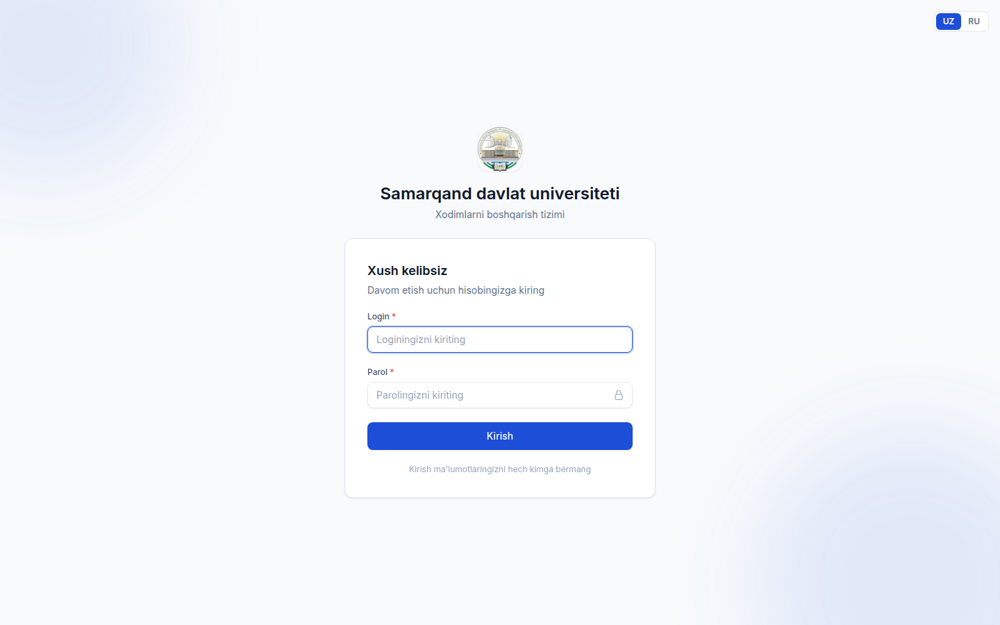

## SUPERADMIN sahifalari

### 02 — Boshqaruv paneli (Superadmin)
Tizim bo'yicha umumiy ko'rsatkichlar: xodimlar soni va holatlar taqsimoti, bugungi davomat nisbati, ochiq vazifalar, oylik ish haqi fondi, bo'limlar soni, o'rtacha KPI, faol sessiyalar va muvaffaqiyatsiz kirishlar. Grafiklar: holatlar bo'yicha doira, davomat dinamikasi, ish haqi fondi trendi, vazifalar holati, so'nggi 24 soatda eng ko'p o'zgartirilgan obyektlar.

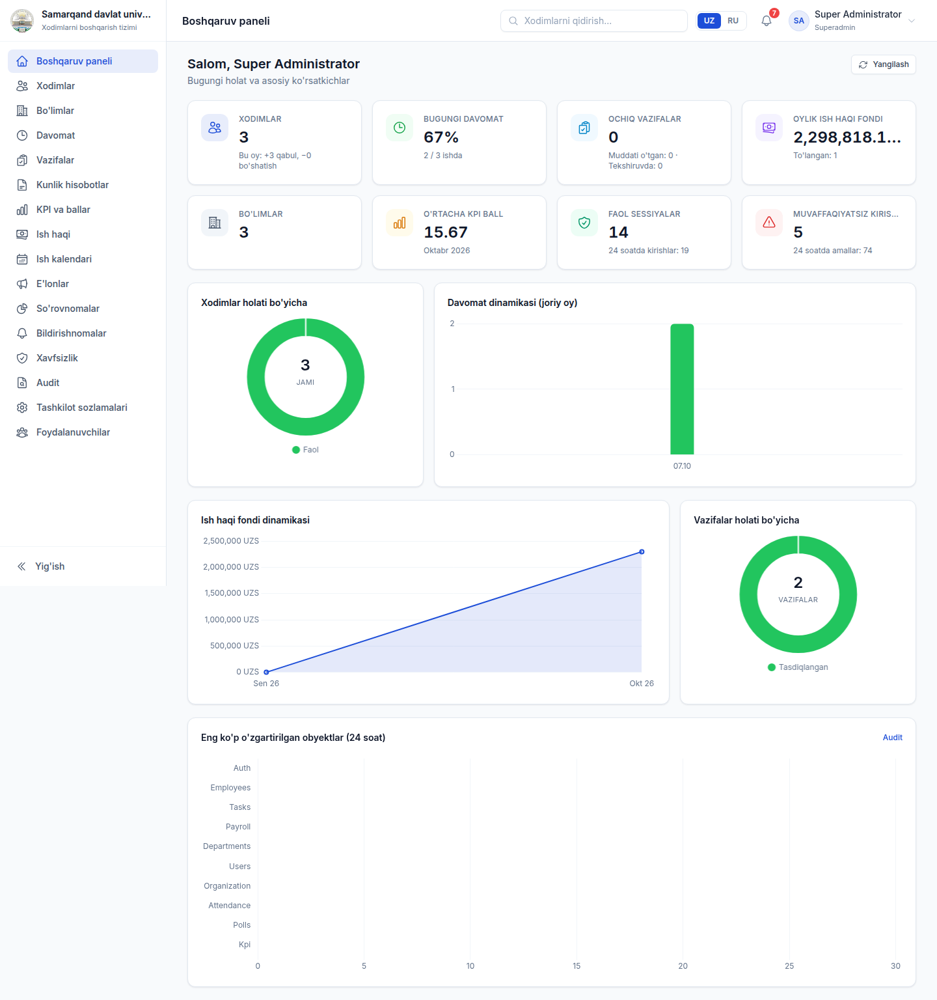

### 03 — Foydalanuvchilar
Barcha tizim foydalanuvchilari ro'yxati (rol, holat, lavozim, oxirgi kirish). HR hisobini yaratish, HR ma'lumotlarini tahrirlash, istalgan foydalanuvchining login va parolini ID bo'yicha topib tiklash (barcha sessiyalari yakunlanadi).

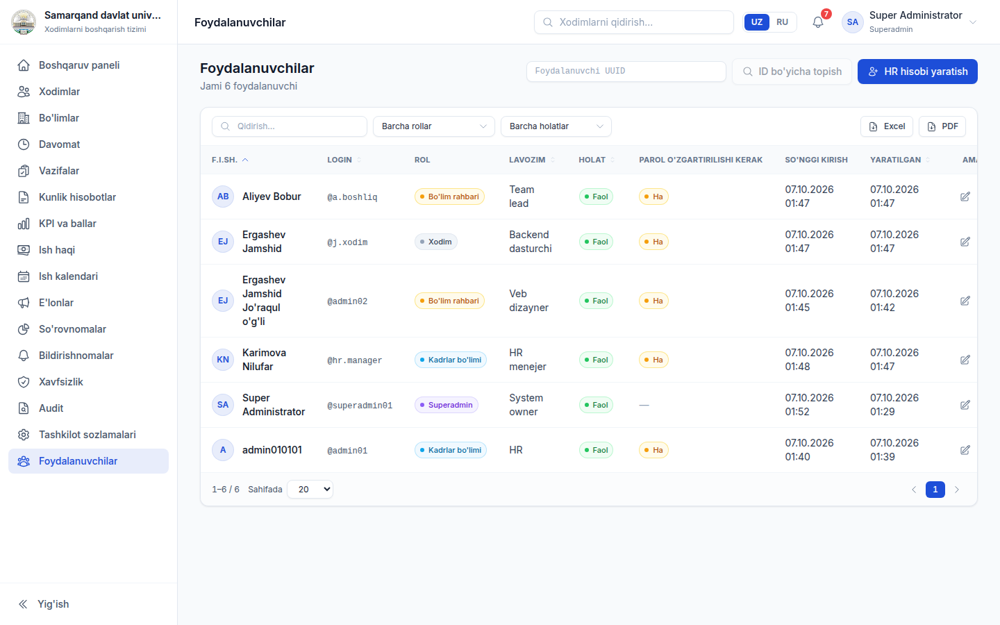

### 04 — Tashkilot sozlamalari
Tashkilot nomi, tavsifi, logotip yuklash, asosiy rang (jonli ko'rinish), valyuta, bitta KPI ball qiymati, bo'lim boshlig'i jamoa bonusi va ball ulushi foizlari, kunlik hisobot muddati soati, hisobot uchun maksimal ball.

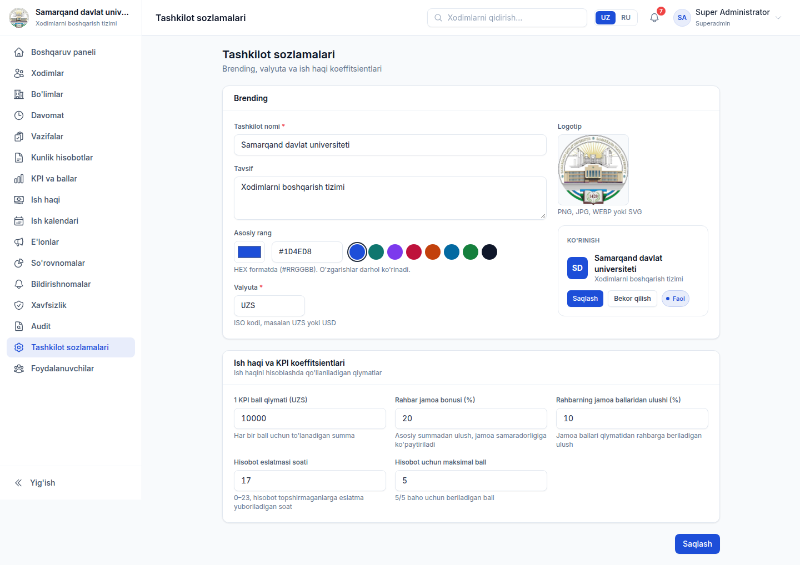

### 05 — Audit jurnali
Uchta bo'lim: amallar jurnali (xodim ID, amal, obyekt, metod, sana va faqat xatolar filtrlari, har bir yozuvda yuborilgan ma'lumotlar), login tarixi (IP, qurilma, brauzer, muvaffaqiyat holati) va butun tashkilot bo'yicha faol sessiyalar.

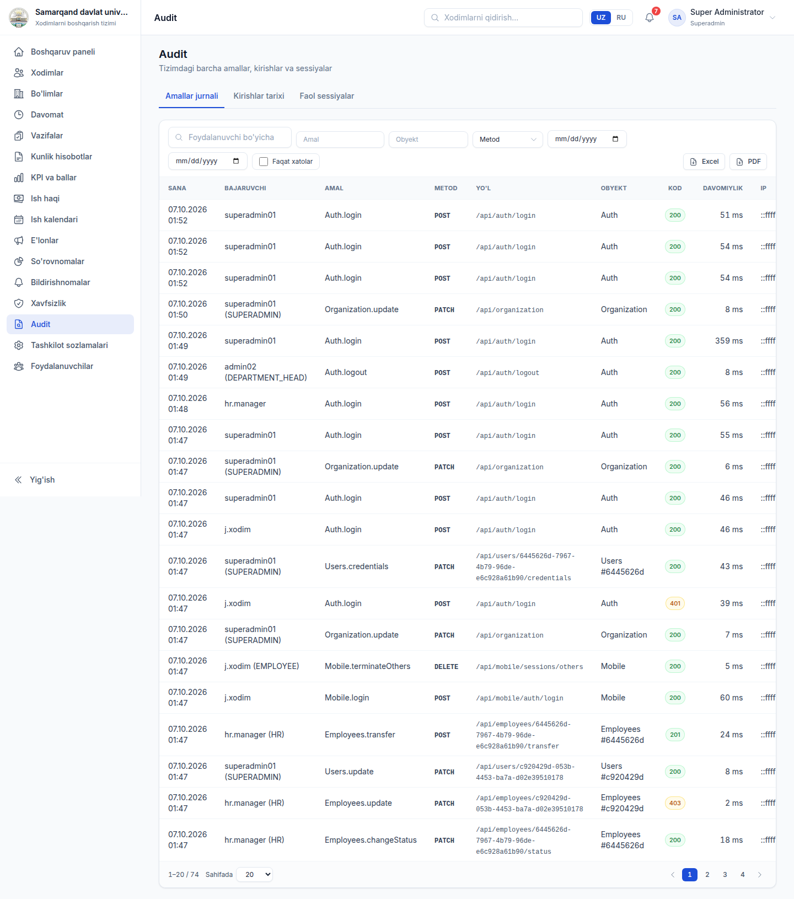

### 06 — Xodimlar ro'yxati
Qidiruv, holat, bo'lim va rol filtrlari bilan jadval; har bir xodim uchun bo'limlar va yuklama foizi chiplari, holat belgisi, asosiy maosh, ishga qabul sanasi. Qatorga bosilganda profil ochiladi.

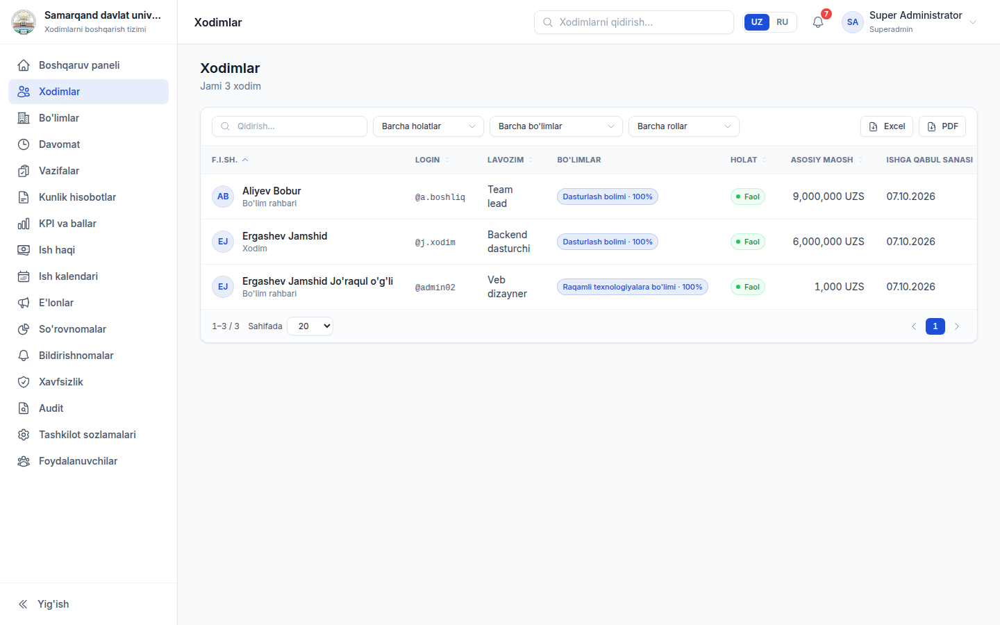

### 07 — Xodim profili
Shaxsiy ma'lumotlar, pasport nusxalari, bo'lim biriktirmalari (tahrirlash va boshqa bo'limga o'tkazish), holat tarixi (muzlatish, ta'til, kasallik varaqasi, ishdan bo'shatish, bloklash), davomat xulosasi, KPI va ish haqi tarixi. Superadmin uchun kirish ma'lumotlarini tiklash tugmasi.

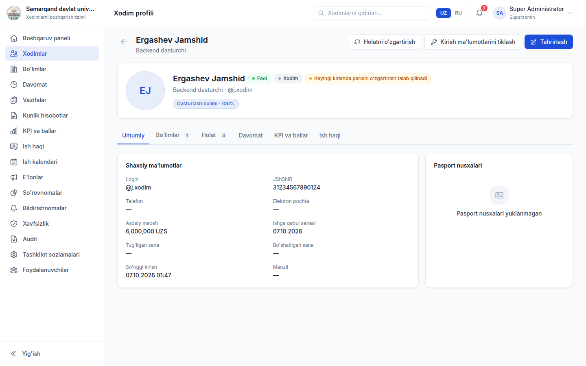

### 08 — Bo'limlar
Bo'limlar ro'yxati: kod, boshliq, a'zolar soni, jami yuklama. HR va superadmin bo'lim yaratadi, tahrirlaydi va boshliq tayinlaydi (xodim roli avtomatik DEPARTMENT_HEAD ga ko'tariladi).

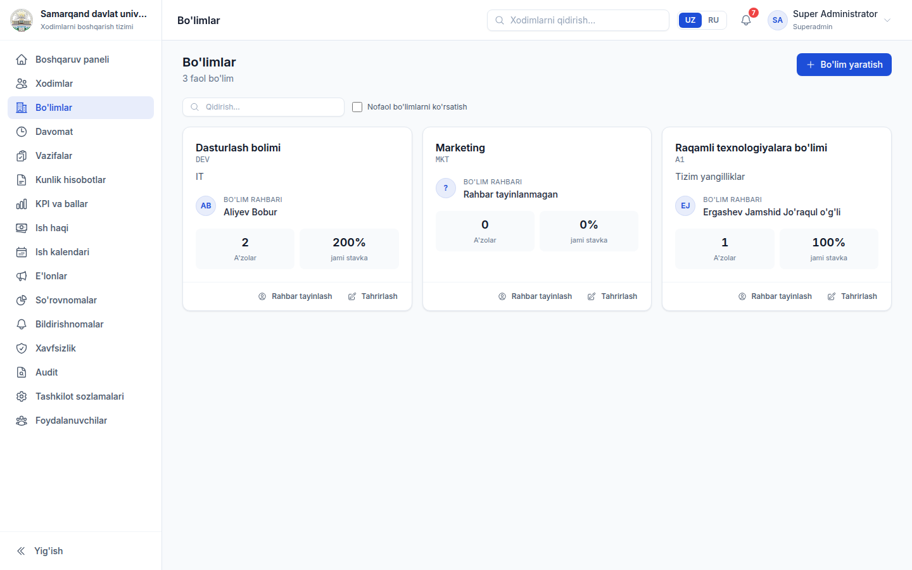

### 09 — Bo'lim tafsiloti
Bo'lim a'zolari jadvali: lavozim, yuklama, holat, boshliq belgisi.

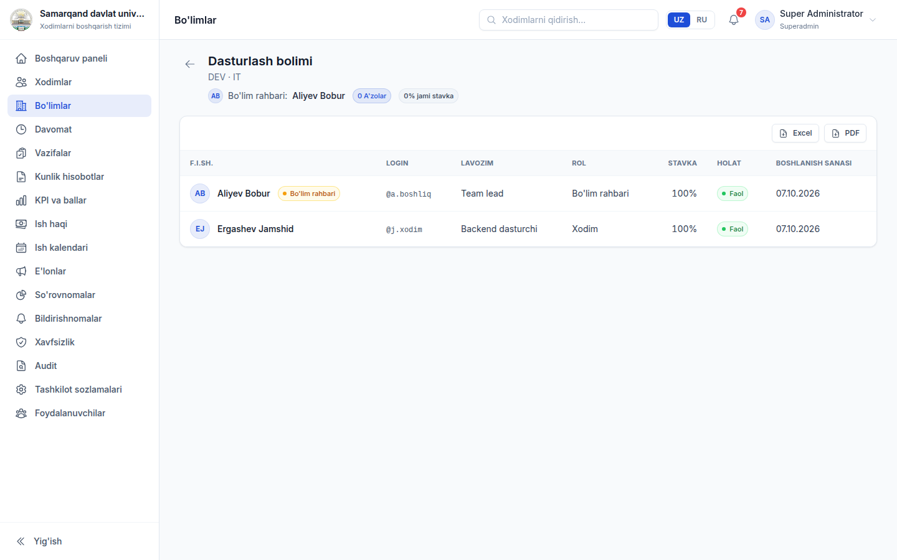

### 10 — Ish kalendari
Oylik taqvim: ish kunlari, dam olish, bayram va norasmiy ish kunlari ranglar bilan. HR kunni bosib turini va nomini belgilaydi yoki standart qoidaga qaytaradi; sana oralig'ini bayram deb belgilash.

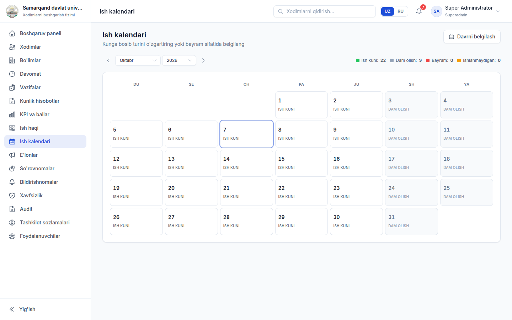

### 11 — E'lonlar
Bo'lim yoki tashkilot miqyosidagi e'lonlar, qadalgan e'lonlar yuqorida, amal qilish muddati. Bo'lim boshlig'i o'z bo'limi, HR butun tashkilot uchun yaratadi.

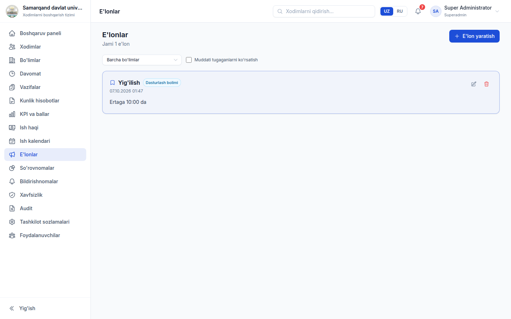

### 12 — So'rovnomalar
Ichki so'rovnomalar: variantlar, ovoz berish, natijalar diagrammasi, anonim rejim, yopish muddati.

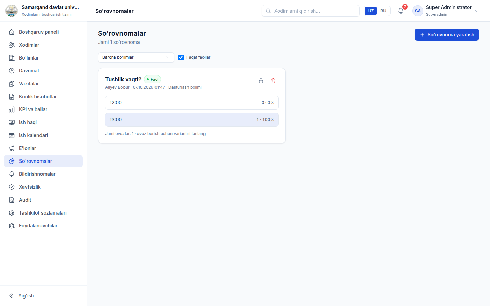

### 13 — Bildirishnomalar
Barcha bildirishnomalar (vazifa, hisobot, ish haqi, e'lon, so'rovnoma, xavfsizlik), o'qilgan deb belgilash, bosilganda tegishli sahifaga o'tish. Real vaqtda Socket.IO orqali keladi.

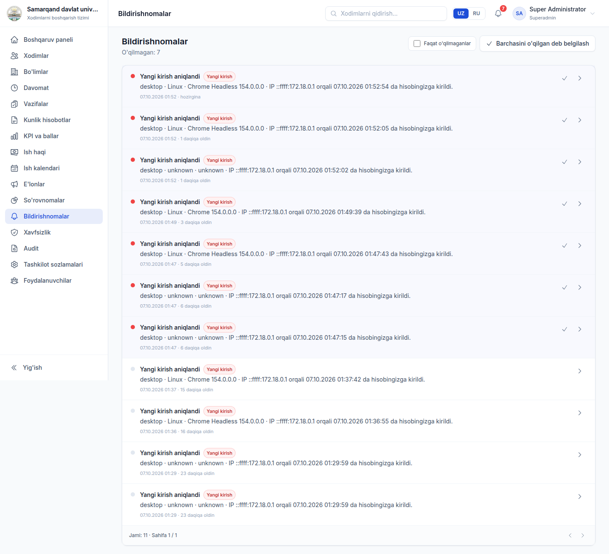

### 14 — Xavfsizlik (sessiyalar)
Foydalanuvchining faol sessiyalari: qurilma, brauzer, OS, IP, so'nggi faollik, joriy sessiya belgisi; bittasini yoki boshqa barchasini yakunlash. Pastda login tarixi.

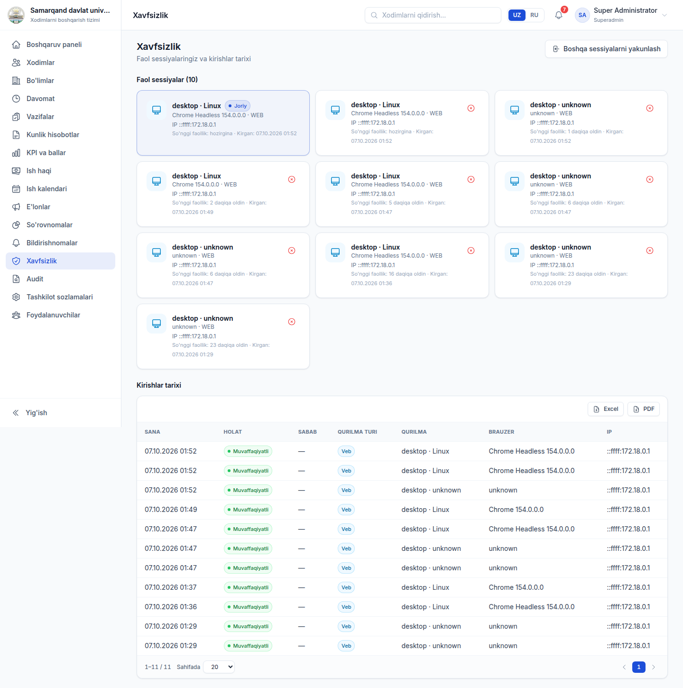

### 15 — Profil
Shaxsiy ma'lumotlar faqat o'qish uchun (ularni HR o'zgartiradi), parolni almashtirish formasi. Vaqtinchalik parol bilan kirilgan bo'lsa, yuqorida ogohlantirish banneri.

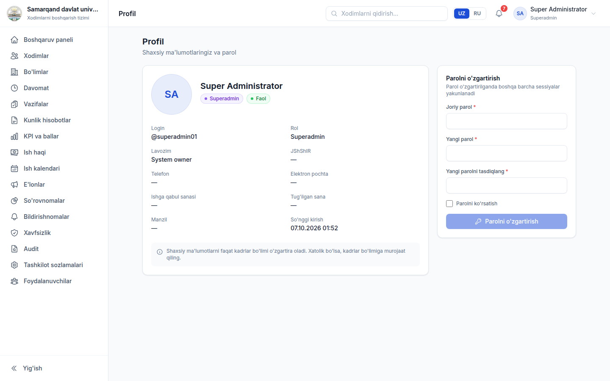

## HR (Xodimlar bo'limi) sahifalari

### 16 — Boshqaruv paneli (HR)
Xodimlar holati, bu oy qabul qilingan va bo'shatilganlar, bugungi davomat, hisobotlar, ish haqi pipeline (hisoblangan / to'langan), eng yaxshi xodimlar.

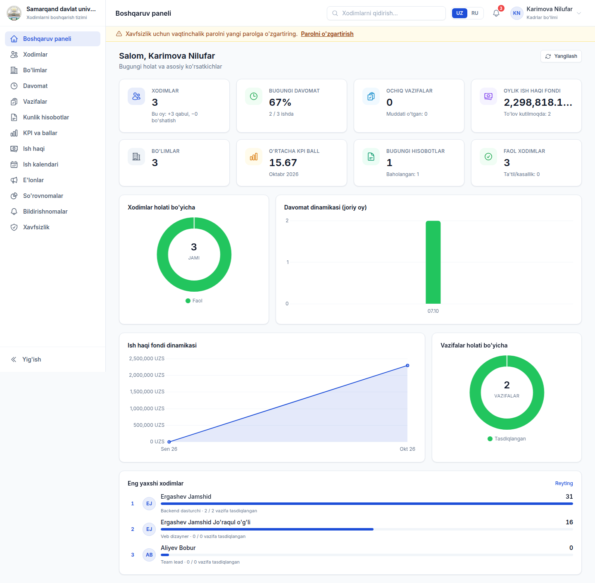

### 17 — Yangi xodim qabul qilish
Onboarding formasi: login va parol (parol generatori), F.I.Sh., JShShIR (14 raqam), telefon, pochta, lavozim, asosiy maosh, sanalar, manzil, fotosurat va pasport nusxalarini yuklash, bo'lim biriktirmalari (25/50/75/100 %, jami 100 % dan oshmasligi jonli tekshiriladi).

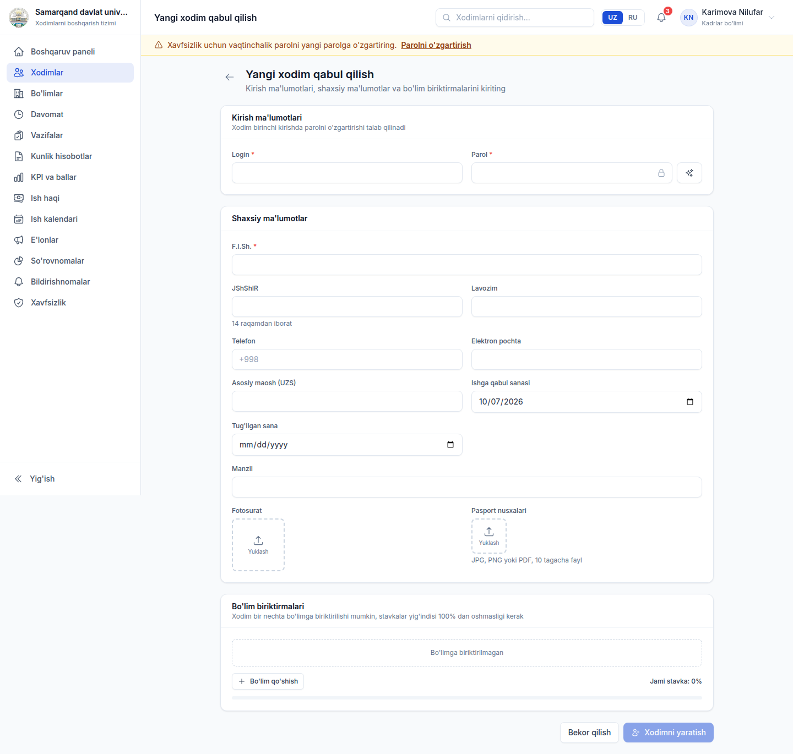

### 18 — Ish haqi (HR)
Oy va bo'lim bo'yicha hisoblash, yozuvlar jadvali (holat, davomat summasi, bonuslar, jami), "To'langan" deb belgilash (shundan so'ng yozuv o'zgarmas), tafsilotlar panelida to'liq hisob-kitob.

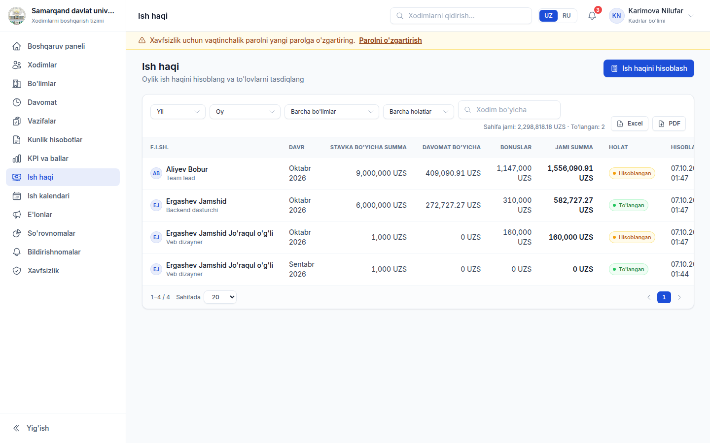

### 19 — Kunlik hisobotlar (HR)
Barcha bo'limlar bo'yicha hisobotlar ro'yxati, sana va bo'lim filtrlari, baho va ballar.

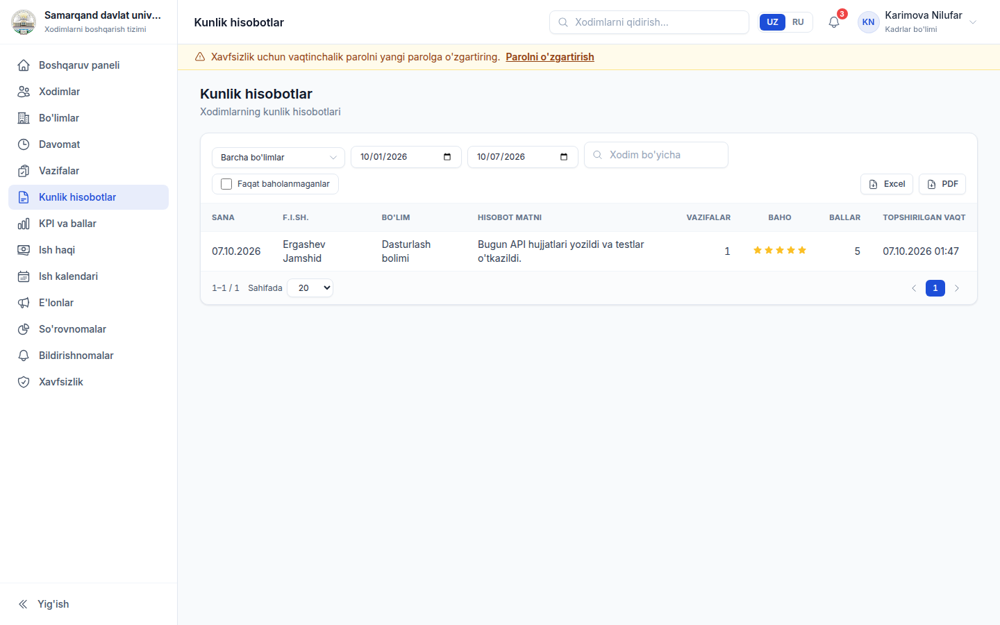

## Bo'lim boshlig'i sahifalari

### 20 — Boshqaruv paneli (bo'lim boshlig'i)
Jamoa a'zolari, bugungi davomat, ochiq va tekshiruv kutayotgan vazifalar, bugungi hisobotlar va topshirmaganlar, faol so'rovnomalar, davomat dinamikasi, vazifalar holati, jamoa reytingi.

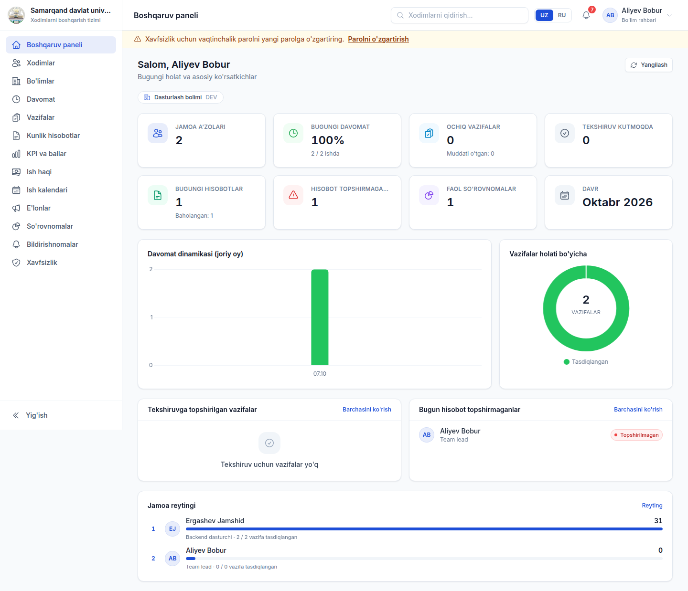

### 21 — Davomat (bugungi varaq)
Faqat joriy kun uchun davomat belgilash: har bir a'zo uchun Ishda / Kech qoldi / Kelmadi / Sababli / Masofadan tugmalari, kelish-ketish vaqti, izoh, bittalab yoki barchasini saqlash. O'tgan sanalar server tomonidan rad etiladi. Qo'shimcha yorliqlar: davomat tarixi va o'z davomati.

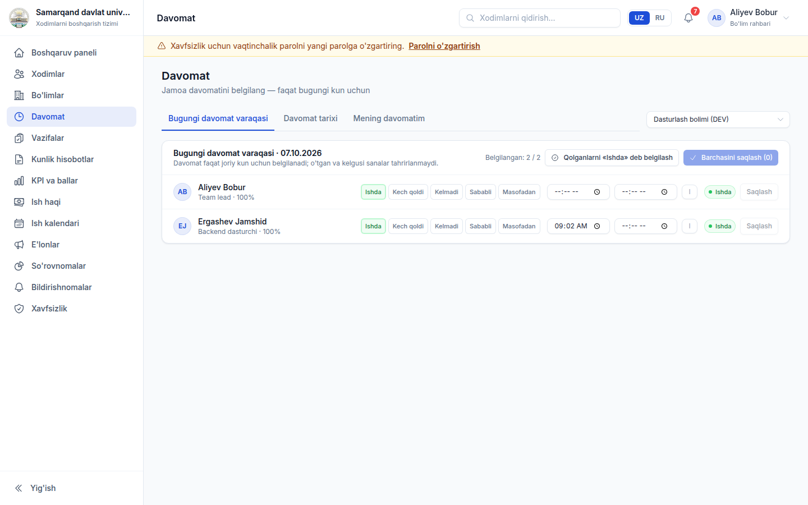

### 22 — Vazifalar (bo'lim boshlig'i)
Oddiy va bonus vazifalar yaratish, tahrirlash, muhimlik va muddat, maksimal ball. Xodim topshirgan vazifalarni tasdiqlash yoki qaytarish, ball berish.

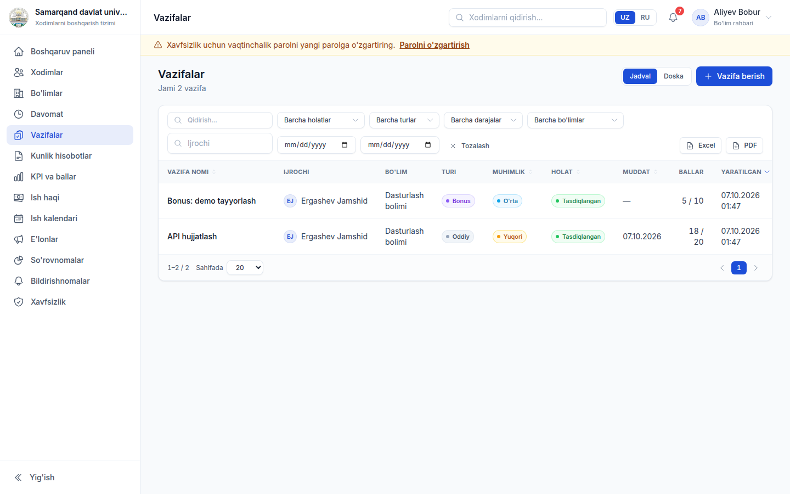

### 23 — Kunlik hisobotlar (bo'lim boshlig'i)
Jamoa hisobotlari, bugun topshirmaganlar paneli, 1-5 yulduz bilan baholash (ball avtomatik hisoblanadi).

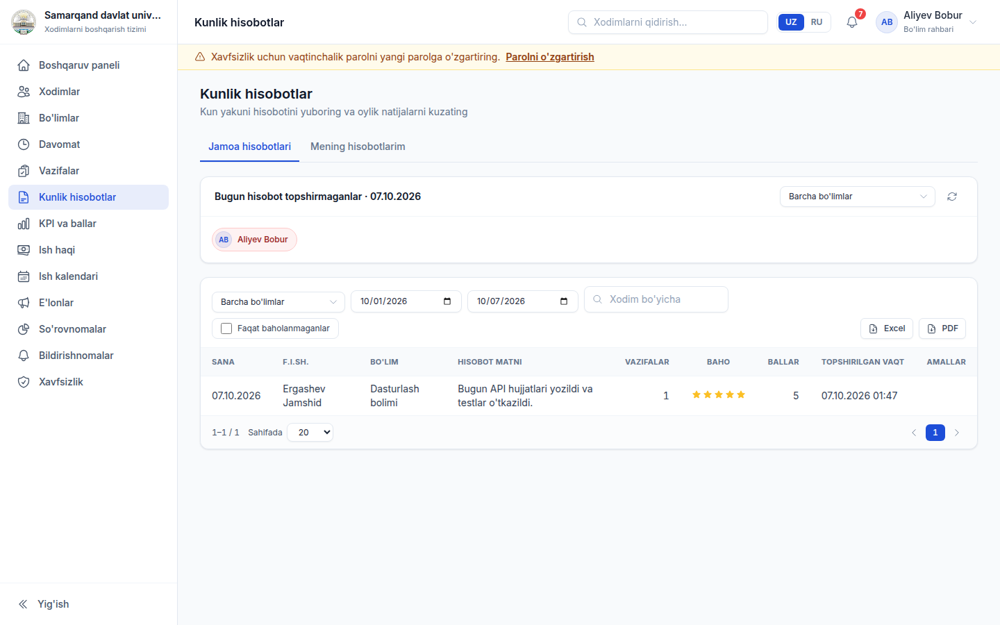

### 24 — KPI va reyting
Jamoa reytingi, bo'lim xulosasi (jami ball, bajarilgan vazifalar nisbati), ballarni qo'lda tuzatish (sabab bilan).

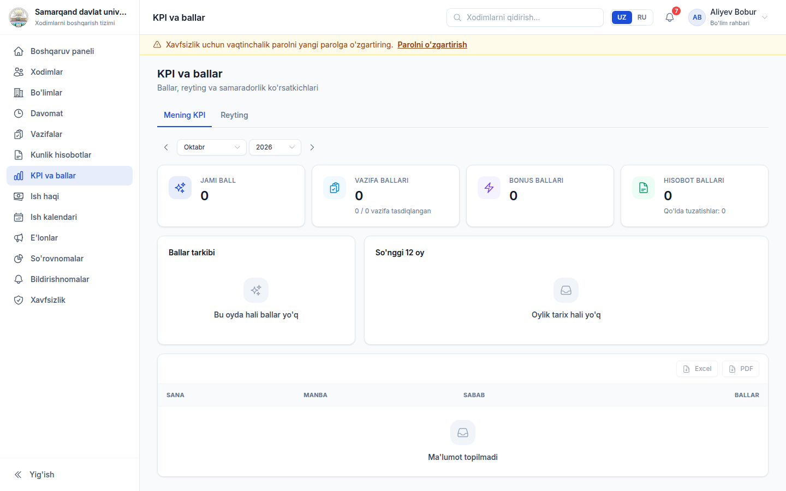

## Xodim sahifalari

### 25 — Boshqaruv paneli (xodim)
Bugungi hisobot holati, joriy oy ballari va tarkibi, davomat ko'rsatkichi, ochiq vazifalar, o'qilmagan bildirishnomalar, so'nggi ish haqi, oylar bo'yicha ballar tarixi.

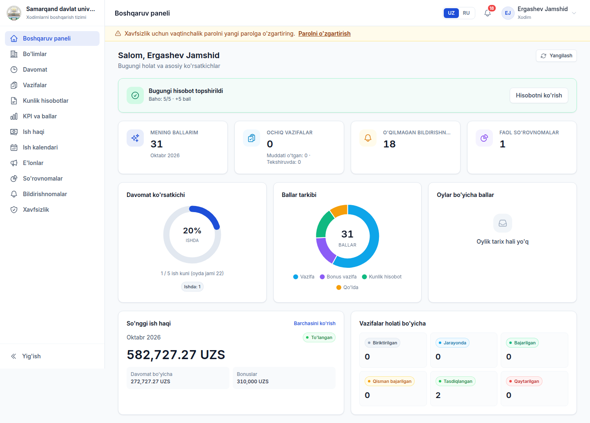

### 26 — Vazifalar (xodim)
Holat bo'yicha guruhlangan vazifalar: boshlash, "Bajarildi" yoki "Qisman bajarildi" deb belgilash, izoh qoldirish, tafsilotlar paneli.

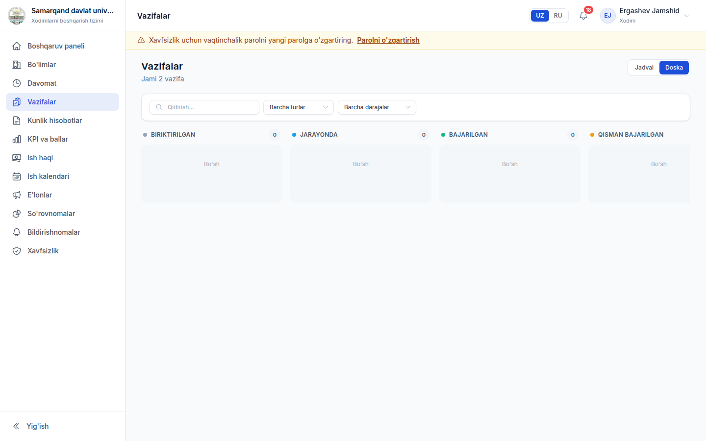

### 27 — Kunlik hisobot (xodim)
Bugungi kun yakuni hisobotini yozish (bajarilgan vazifalarni tanlash bilan), oy bo'yicha hisobotlar va olingan baholar. Yuborilmagan bo'lsa belgilangan soatda eslatma keladi.

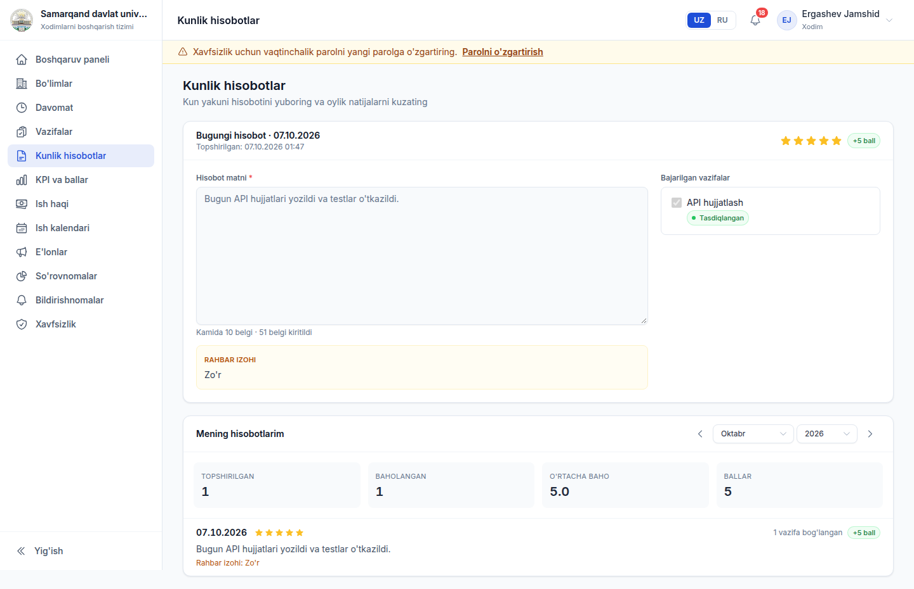

### 28 — KPI (xodim)
Joriy oy ballari tarkibi (vazifa, bonus, hisobot, qo'lda), tranzaksiyalar jadvali, 12 oylik tarix. Ballar har oyning 1-kuni noldan boshlanadi.

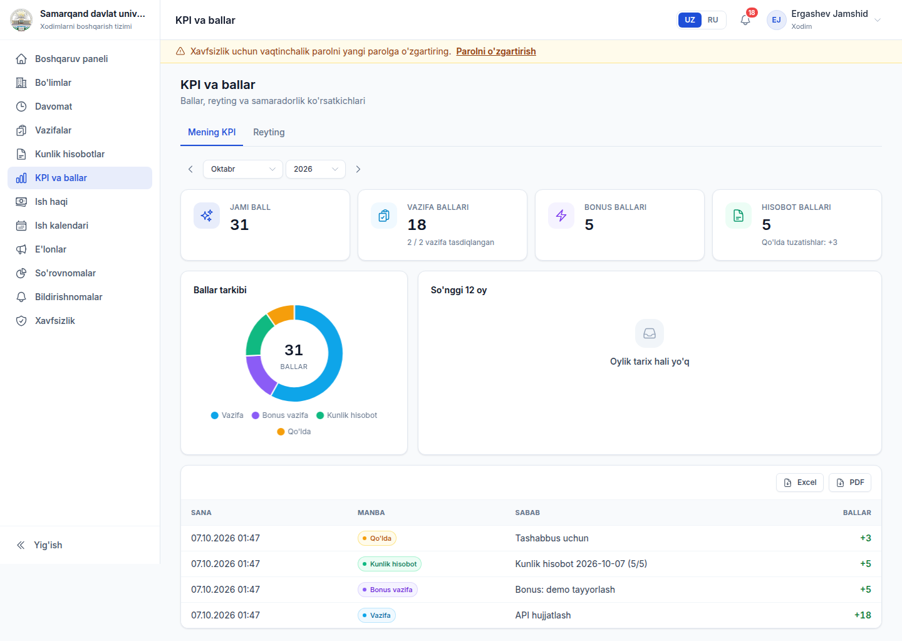

### 29 — Ish haqi (xodim)
O'z ish haqi tarixi, holatlar va har bir oy uchun hisob-kitob tafsilotlari.

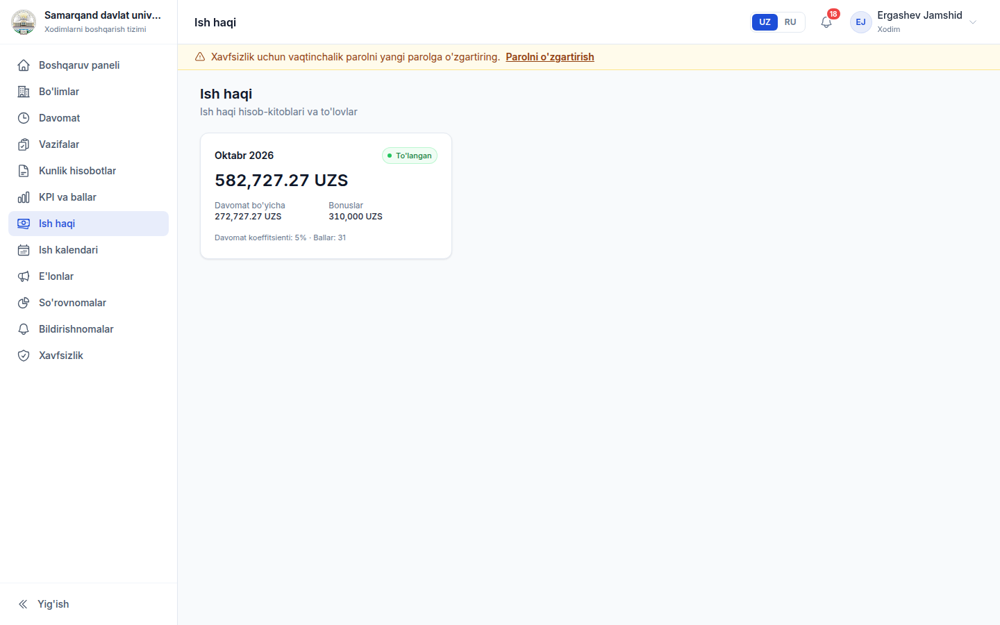

### 30 — Davomat (xodim)
Oylik taqvim ko'rinishida shaxsiy davomat, ish kunlari va kelgan kunlar statistikasi.

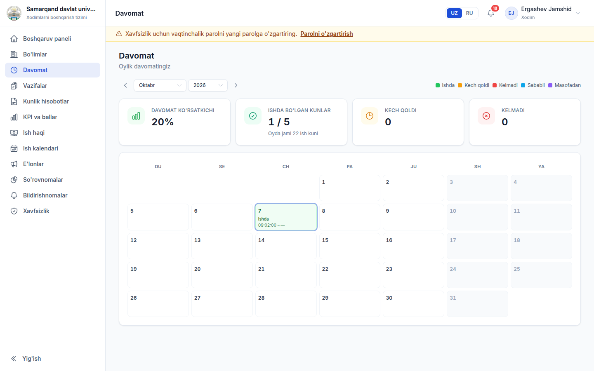

## API hujjatlari (Swagger)

### 31 — Backend Swagger
`http://localhost:3000/api/docs` — 19 ta teg bo'yicha guruhlangan barcha endpointlar, Bearer avtorizatsiya, har bir endpoint uchun DTO va misollar.

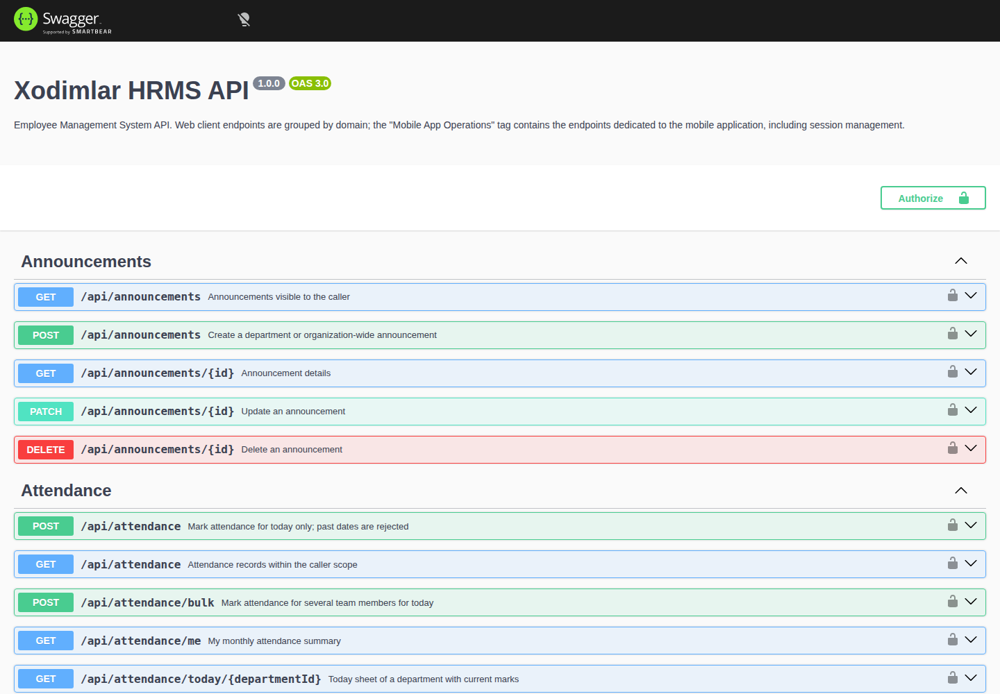

### 32 — Mobile App Operations
Mobil ilova uchun ajratilgan bo'lim: login (qurilma ro'yxati bilan), refresh, logout, parol almashtirish, profil, sessiyalar ro'yxati, bitta yoki boshqa barcha sessiyalarni yakunlash, login tarixi, dashboard, bildirishnomalar.

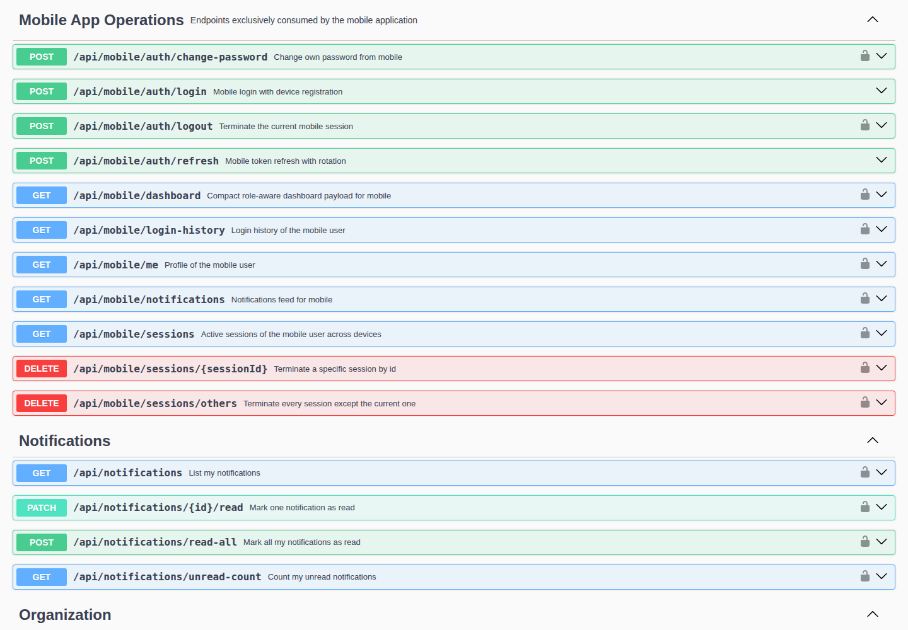

### 33 — File-service Swagger
`http://localhost:3001/docs` — fayl yuklash (PHOTO, PASSPORT, LOGO, DOCUMENT), metadata, kontent oqimi, o'chirish, health.

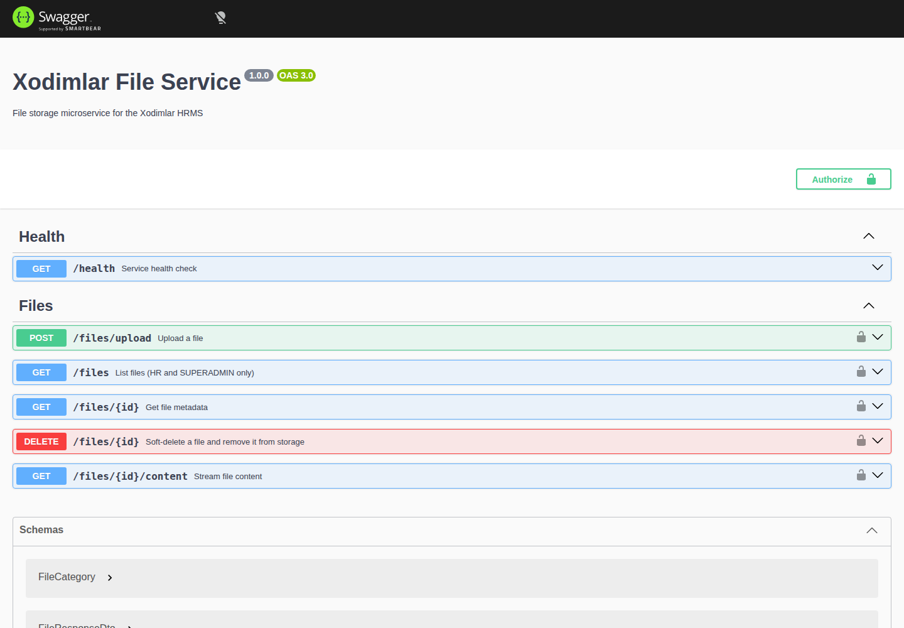
